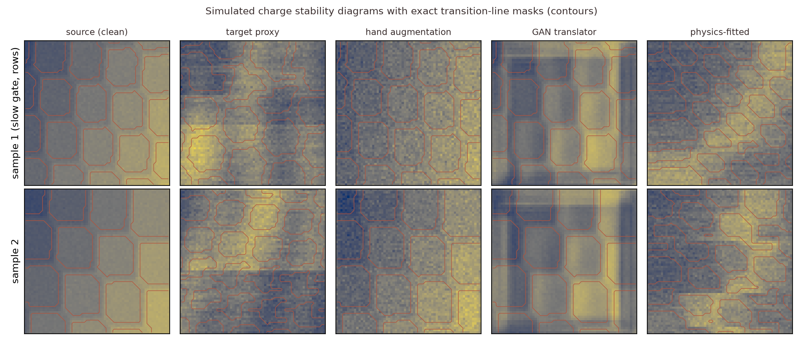
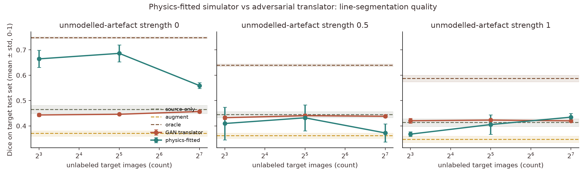
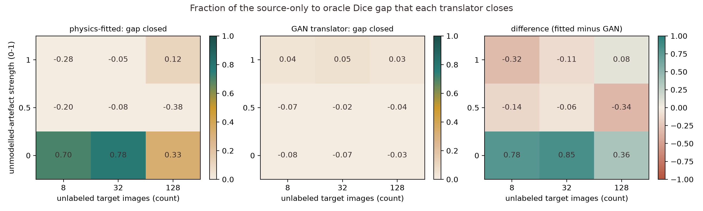
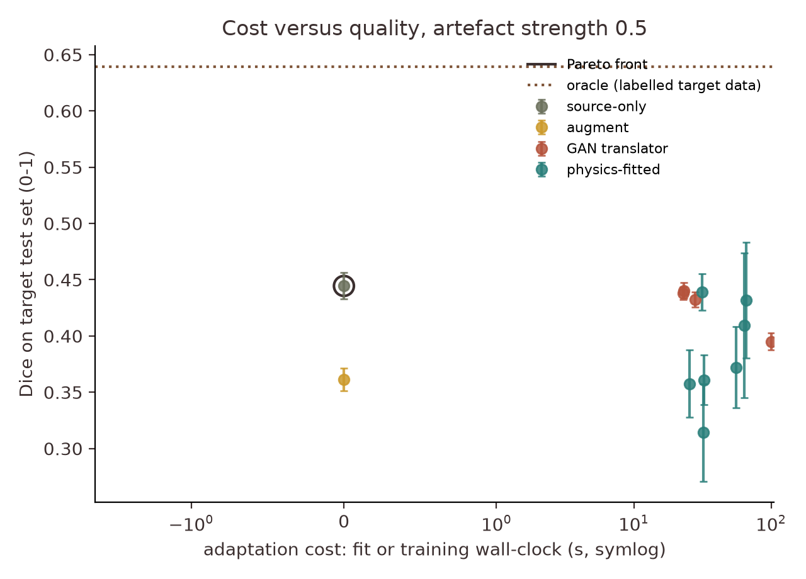
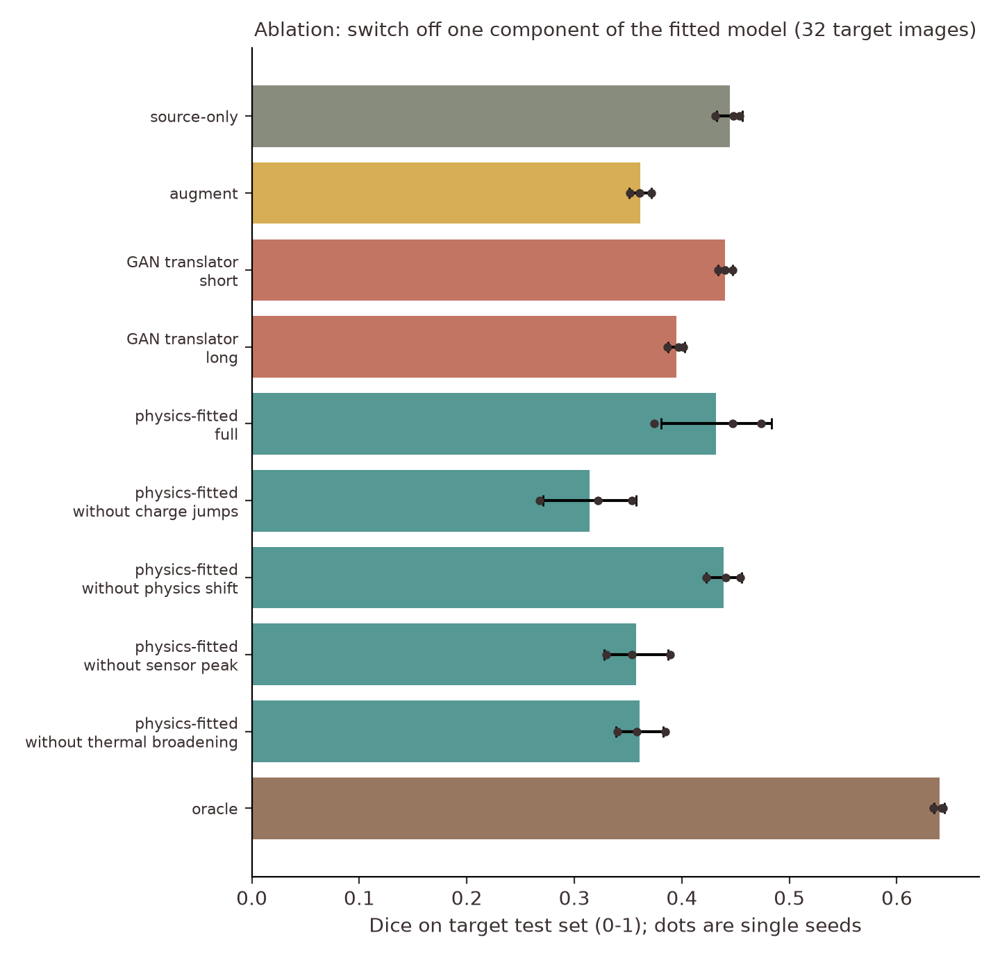

# Does fitting a physics simulator beat a generative adversarial network for charge stability diagrams?

[](LICENSE)
[](pyproject.toml)
[](.github/workflows/ci.yml)

**Research question.** If only a handful of unlabeled measurements of a double quantum dot exist, is it better to fit the parameters of a physics-structured simulator to them, or to train a free-form generative adversarial network (GAN) that translates clean simulated images into measurement-like ones?

**One-line answer (simulation only).** Fitting wins clearly when the measurement effects lie inside the simulator's model family (32 unlabeled images close 0.78 ± 0.13 of the gap to an oracle, the GAN closes -0.07 ± 0.05), but as soon as unmodelled artefacts appear (strength 0.5 and 1.0) the fit falls to or below the no-adaptation baseline, and the GAN never beats that baseline either.

## Abstract

Charge stability diagrams (CSDs) of a double quantum dot are simulated with a constant-interaction model (CIM) and degraded by an 11-parameter measurement layer (thermal broadening, Coulomb-peak sensor response, 1/f drift, telegraph charge jumps, cross-talk). On a laboratory-like proxy target, three ways of using 8, 32 or 128 unlabeled target images are compared on a downstream transition-line segmentation task: fitting the simulator parameters by statistics matching, an unpaired CycleGAN-style translator, and hand-set augmentation, against source-only training and a labelled oracle, over 3 seeds and 3 strengths of unmodelled artefacts. The result is a map of when each approach helps, including negative results: fitting is excellent inside its model family and unreliable outside it, and a GAN with realistic-looking output can still lower downstream accuracy.

## Motivation

Silicon spin-qubit devices are tuned from CSDs, and physics simulators give unlimited images with exact labels, but measured images differ from simulated ones. Closing that simulation-to-measurement gap with generative models, synthetic data and domain adaptation is an open practical problem. The gap is rarely studied under the two conditions that matter in a laboratory: very few unlabeled measurements, and effects the simulator does not contain. No real measurements are used here: the "target" is a harsher simulator (a proxy), so everything below is a controlled study of method behaviour, not a statement about a particular device.

## Research gap and related work

The full table of 14 papers is in [`docs/RESEARCH_GAP.md`](docs/RESEARCH_GAP.md). The papers supplied for this study contain no work on spin-qubit images, so the closest material is used:

- Noise must be modelled per device and mitigation depends on the dominant noise type (Cai et al., 2023, digital object identifier (DOI) 10.1103/RevModPhys.95.045005; Kim et al., 2023, DOI 10.1038/s41586-023-06096-3; Acharya et al., 2023, DOI 10.1038/s41586-022-05434-1). Rare correlated events appear only in real data (Zobrist et al., 2025, DOI 10.1038/s41586-024-08449-y).
- Pretraining on simulation and fine-tuning on little target data works, and explicit physical constraints help (Deng et al., 2023, DOI 10.1038/s42256-023-00716-3; Lin et al., 2027, DOI 10.1016/j.ces.2026.124987; Xu et al., 2027, DOI 10.1016/j.saa.2026.128945), but these studies use tabular or spectral data and need target labels or target simulations.
- Physical-model parameters can be tied to calibration data (Du et al., 2027, DOI 10.1016/j.future.2026.108830).

**Gap:** none of these compares, on images, a parameter-fitted physics generator with an adversarial translator while sweeping the number of unlabeled target images against the strength of unmodelled effects.

## What is new here

- A controlled sweep of unlabeled-target-set size against *unmodelled-artefact strength*, which exposes where parameter fitting stops being safe.
- Exact labels through the generator: charge jumps move the transition-line labels together with the image, so the label fidelity of each method shows up in downstream accuracy.
- A realism metric that is independent of the fit objective (random-feature Fréchet distance (RF-FD)), which shows that realistic-looking output and useful training data are different things.
- A leave-one-component-out ablation of the measurement layer.

## Method

```mermaid
%%{init: {'theme': 'base', 'themeVariables': {'primaryColor': '#ffffff', 'primaryTextColor': '#000000', 'primaryBorderColor': '#000000', 'lineColor': '#000000', 'secondaryColor': '#ffffff', 'tertiaryColor': '#ffffff', 'background': '#ffffff', 'noteBkgColor': '#ffffff', 'noteTextColor': '#000000', 'actorBkg': '#ffffff', 'actorBorder': '#000000', 'actorTextColor': '#000000', 'signalColor': '#000000', 'signalTextColor': '#000000', 'labelBoxBkgColor': '#ffffff', 'labelTextColor': '#000000', 'clusterBkg': '#ffffff', 'clusterBorder': '#000000'}}}%%
flowchart TD
  subgraph IN["Inputs: simulator.py"]
    A["Source domain<br/>clean constant-interaction model<br/>exact line masks"]
    B["Target proxy<br/>11-parameter measurement layer<br/>plus unmodelled artefacts"]
  end
  subgraph ADAPT["Adaptation: fit.py and translators.py"]
    C["Physics-fitted<br/>differential evolution on<br/>24 image statistics"]
    D["GAN translator<br/>CycleGAN-style, unpaired"]
    E["Augment<br/>hand-set noise and blur"]
  end
  subgraph EVAL["Evaluation: segmenter.py and pipeline.py"]
    F["U-Net line segmenter<br/>trained on 768 images"]
    G["Dice score on 512 held-out<br/>target images, 3 seeds"]
    H["RF-FD realism score<br/>random-feature Frechet distance"]
  end
  A --> C
  A --> D
  A --> E
  B --> C
  B --> D
  C --> F
  D --> F
  E --> F
  F --> G
  C --> H
  D --> H
  classDef bw fill:#ffffff,stroke:#000000,color:#000000,stroke-width:2px;
  class A,B,C,D,E,F,G,H bw;
```

Legend: GAN = generative adversarial network; U-Net = convolutional encoder-decoder network; Dice = overlap score between predicted and true line pixels; RF-FD = random-feature Fréchet distance. The source-only and oracle runs also train the U-Net directly (clean images, or labelled target-proxy images).

Summary (details in [`docs/METHOD.md`](docs/METHOD.md)): the CIM gives exact ground-state boundaries, and the measurement layer turns Boltzmann-weighted occupations into sensor images. **Physics-fitted** fits the 11 parameters (a differential-evolution search) so that 24 image statistics of 24 simulated images match those of the N unlabeled target images, then renders 768 labelled images. **GAN translator** maps clean images to target-like images and inherits the clean labels. All methods train the same 0.12 M-parameter U-Net and are scored on the same held-out target-proxy images. Sweeps: N in {8, 32, 128} by artefact strength in {0, 0.5, 1}; ablation and a longer GAN run at N = 32, strength 0.5; seeds 0, 1, 2.

## Results

All numbers are mean ± standard deviation over 3 seeds, copied from `results/summary.csv` (per-run values in `results/raw_runs.csv`, the same tables in `results/tables.md`). *Gap closed* = (Dice method - Dice source-only) / (Dice oracle - Dice source-only), per seed. RF-FD is scaled by 1000, lower is more realistic. Adaptation seconds are wall-clock with three seeds sharing one GPU.

### Dice and gap closed by artefact strength and number of unlabeled target images

| artefact strength | method | unlabeled target images | Dice | gap closed | RF-FD x1000 | adaptation s |
|---|---|---|---|---|---|---|
| 0 | oracle | - | 0.748 ± 0.003 | - | 0.00 ± 0.00 | 0 |
| 0 | physics-fitted | 8 | 0.664 ± 0.034 | 0.70 ± 0.13 | 0.07 ± 0.01 | 64 |
| 0 | physics-fitted | 32 | 0.686 ± 0.033 | 0.78 ± 0.13 | 0.02 ± 0.00 | 65 |
| 0 | physics-fitted | 128 | 0.559 ± 0.011 | 0.33 ± 0.02 | 0.08 ± 0.05 | 71 |
| 0 | GAN translator | 8 | 0.443 ± 0.006 | -0.08 ± 0.06 | 0.15 ± 0.05 | 26 |
| 0 | GAN translator | 32 | 0.446 ± 0.003 | -0.07 ± 0.05 | 0.13 ± 0.04 | 27 |
| 0 | GAN translator | 128 | 0.457 ± 0.006 | -0.03 ± 0.04 | 0.13 ± 0.04 | 27 |
| 0 | augment | - | 0.370 ± 0.010 | -0.34 ± 0.09 | 0.56 ± 0.01 | 0 |
| 0 | source-only | - | 0.465 ± 0.016 | - | 0.48 ± 0.00 | 0 |
| 0.5 | oracle | - | 0.639 ± 0.005 | - | 0.00 ± 0.00 | 0 |
| 0.5 | physics-fitted | 8 | 0.409 ± 0.065 | -0.20 ± 0.41 | 0.28 ± 0.03 | 64 |
| 0.5 | physics-fitted | 32 | 0.432 ± 0.051 | -0.08 ± 0.33 | 0.15 ± 0.14 | 66 |
| 0.5 | physics-fitted | 128 | 0.372 ± 0.036 | -0.38 ± 0.22 | 0.25 ± 0.01 | 56 |
| 0.5 | GAN translator | 8 | 0.432 ± 0.007 | -0.07 ± 0.06 | 0.16 ± 0.07 | 28 |
| 0.5 | GAN translator | 32 | 0.440 ± 0.007 | -0.02 ± 0.05 | 0.14 ± 0.02 | 23 |
| 0.5 | GAN translator | 128 | 0.438 ± 0.006 | -0.04 ± 0.04 | 0.14 ± 0.04 | 23 |
| 0.5 | augment | - | 0.361 ± 0.010 | -0.43 ± 0.08 | 0.55 ± 0.01 | 0 |
| 0.5 | source-only | - | 0.444 ± 0.012 | - | 0.50 ± 0.00 | 0 |
| 1 | oracle | - | 0.587 ± 0.013 | - | 0.00 ± 0.00 | 0 |
| 1 | physics-fitted | 8 | 0.367 ± 0.009 | -0.28 ± 0.16 | 0.34 ± 0.02 | 59 |
| 1 | physics-fitted | 32 | 0.405 ± 0.038 | -0.05 ± 0.25 | 0.31 ± 0.08 | 55 |
| 1 | physics-fitted | 128 | 0.435 ± 0.014 | 0.12 ± 0.11 | 0.17 ± 0.02 | 57 |
| 1 | GAN translator | 8 | 0.420 ± 0.010 | 0.04 ± 0.05 | 0.20 ± 0.03 | 32 |
| 1 | GAN translator | 32 | 0.423 ± 0.005 | 0.05 ± 0.07 | 0.18 ± 0.01 | 23 |
| 1 | GAN translator | 128 | 0.420 ± 0.006 | 0.03 ± 0.08 | 0.18 ± 0.03 | 24 |
| 1 | augment | - | 0.347 ± 0.012 | -0.39 ± 0.08 | 0.56 ± 0.01 | 0 |
| 1 | source-only | - | 0.413 ± 0.015 | - | 0.56 ± 0.00 | 0 |

### Ablation and GAN budget check (32 unlabeled images, artefact strength 0.5)

| method | variant | Dice | gap closed | RF-FD x1000 | adaptation s |
|---|---|---|---|---|---|
| GAN translator | long | 0.395 ± 0.008 | -0.26 ± 0.04 | 0.09 ± 0.02 | 100 |
| GAN translator | short | 0.440 ± 0.007 | -0.02 ± 0.05 | 0.14 ± 0.02 | 23 |
| augment | - | 0.361 ± 0.010 | -0.43 ± 0.08 | 0.55 ± 0.01 | 0 |
| oracle | - | 0.639 ± 0.005 | - | 0.00 ± 0.00 | 0 |
| physics-fitted | full | 0.432 ± 0.051 | -0.08 ± 0.33 | 0.15 ± 0.14 | 66 |
| physics-fitted | without charge jumps | 0.314 ± 0.043 | -0.66 ± 0.11 | 0.35 ± 0.01 | 32 |
| physics-fitted | without physics shift | 0.439 ± 0.016 | -0.03 ± 0.13 | 0.32 ± 0.04 | 31 |
| physics-fitted | without sensor peak | 0.358 ± 0.030 | -0.45 ± 0.14 | 0.24 ± 0.04 | 26 |
| physics-fitted | without thermal broadening | 0.361 ± 0.022 | -0.44 ± 0.20 | 0.27 ± 0.02 | 32 |
| source-only | - | 0.444 ± 0.012 | - | 0.50 ± 0.00 | 0 |




*Figure 1. Clean source, target proxy (strength 0.5), hand augmentation, GAN output and fitted-simulator output with exact line masks; the GAN output shows smooth blocks and banding artefacts, and its inherited masks are not guaranteed to follow them.*



*Figure 2. Only the physics-fitted simulator beats source-only training, and only at artefact strength 0; more unlabeled images do not help the fit (128 images are worse than 32 at strength 0).*



*Figure 3. The advantage of fitting over the GAN (right panel) is large inside the model family and flips sign once unmodelled artefacts are present.*



*Figure 4. At artefact strength 0.5 the fit costs about a minute of wall-clock time and does not buy accuracy over the free baselines.*



*Figure 5. Removing charge jumps, the sensor peak or thermal broadening from the fitted model costs 0.07 to 0.12 Dice; removing the physics shift costs nothing measurable.*

## Discussion

- **Hypothesis H1 (partly confirmed).** At 32 images and strength 0, fitting closes 0.78 ± 0.13 of the gap, just under the pre-set threshold of 0.8, and exceeds the GAN by 0.85, well above the required 0.1.
- **Hypothesis H2 (confirmed).** The fitted-minus-GAN difference at 32 images goes from 0.85 (strength 0) to -0.06 (0.5) and -0.11 (1.0).
- **Outside its family the fit is not only worse, it can be harmful.** At strength 0.5 and 32 images the fit has Dice 0.432 ± 0.051 against 0.444 ± 0.012 for source-only (a large seed spread, so the two are statistically close), yet RF-FD falls from 0.50 to 0.15: the images look far more realistic while the labels become less useful. The fitted parameters hint at a compensation mechanism: the background tilt, true value 0.25, is fitted at 0.253, 0.290 and 0.206 (strength 0, for 8, 32, 128 images) but at -0.412, -0.067 and -0.433 (strength 0.5), and cross-talk drops from about 0.2 to 0.05-0.16. I did not test this mechanism in a controlled experiment, so it is a plausible explanation only (values from `results/fitted_parameters.json`).
- **More data did not help the fit.** With 128 images at strength 0 the gap closed drops to 0.33 ± 0.02 and the fitted temperature is roughly twice the true value. I have not diagnosed this; likely causes are the standardised-statistics objective and the small search budget (14 generations, population of 6 per dimension), not a property of the idea.
- **The GAN is safe but useless here.** It stays within about ±0.08 gap closed of source-only everywhere. The longer GAN run (800 steps) improves realism (RF-FD 0.09 ± 0.02 against 0.14 ± 0.02) but lowers Dice (0.395 ± 0.008 against 0.440 ± 0.007): a more realistic image with an inherited mask is a worse training pair when the target has charge jumps that move the lines.
- **Hand augmentation hurts** (Dice 0.361 ± 0.010 against 0.444 ± 0.012 at strength 0.5): generic noise and blur ranges chosen without target knowledge do not match the target.
- **Ablation.** Charge jumps matter most (Dice 0.314 ± 0.043 without them), then the sensor peak (0.358 ± 0.030) and thermal broadening (0.361 ± 0.022); the physics shift (coupling and cross-talk) can be frozen at no measurable cost (0.439 ± 0.016).

## Limitations

- No real data: the target is a simulator proxy built from the model family the fit searches, which favours the fit at strength 0.
- 64 x 64 pixel images, one device type, one downstream task, 3 seeds; standard deviations from 3 seeds are rough.
- The GAN is small and was trained for 180 steps (800 in the budget check) without tuning; a stronger, label-aware translator may do better. The fit used a small differential-evolution budget and was not tuned either.
- The three seeds ran in parallel on one GPU, so adaptation times are inflated and comparable only within this study.
- No claim about quantum advantage is made: no quantum circuit is involved.

## Future work

- Replace the proxy by measured CSDs labelled by an experienced operator, and test whether the compensation effect appears.
- Add a mismatch term (a residual network on top of the parameter-fitted simulator) so that unmodelled artefacts are absorbed by a part of the model that cannot move the labels.
- Make the measurement layer differentiable and fit by gradient descent with uncertainty (simulation-based inference) so that more unlabeled images do not degrade the fit.
- Extend to quantum-dot arrays and to tuning tasks such as dot-number identification and virtual-gate extraction.

## Reproducibility

```bash
pip install -r requirements.txt            # pinned versions
python -m pytest -q                         # 7 fast tests
python experiments/run_all.py --quick       # smoke run (CPU is fine)
python experiments/run_all.py               # full study, 3 seeds, writes results/ and figures/
python experiments/make_tables.py           # markdown tables from results/summary.csv
```

The full run took 1539 s (about 26 min) of wall-clock time with three seeds in parallel processes on one NVIDIA GeForce RTX 5050 Laptop graphics processing unit (GPU, 8 GB), Windows 11, Python 3.11.9, PyTorch 2.11.0 with CUDA 12.8 (`results/run_meta.json`). This is above the 15-minute compute target I had set for the study; the GPU work is launch-bound, so parallel seeds were the cheapest remedy. Seeds are fixed, but GPU results are not guaranteed bit-identical across machines.

## Project structure

```
src/csdgap/      simulator.py (CIM + measurement layer), features.py, fit.py, translators.py (GAN, augmentation),
                 segmenter.py (U-Net, Dice), pipeline.py (one seed of the study)
experiments/     run_all.py, make_figures.py, make_tables.py
tests/           test_csdgap.py
docs/            RESEARCH_GAP.md, METHOD.md
results/         raw_runs.csv, summary.csv, tables.md, fitted_parameters.json, run_meta.json
figures/         fig1 to fig5 (200 dpi)
```

## Related work by the author

- [noisy-quantum-proposal-mcmc-gauge-bias](https://github.com/pradeepdegalaroyal/noisy-quantum-proposal-mcmc-gauge-bias): how hardware noise biases sampling, with exact transition matrices and mitigation ablations.
- [rydberg-eit-rf-estimation-vqc-vs-fit](https://github.com/pradeepdegalaroyal/rydberg-eit-rf-estimation-vqc-vs-fit): a model fit versus learned estimators under drift and detection noise, the same fit-versus-learn question on a different sensor.

## Citation

```bibtex
@software{degala_chargestability_2026,
  author   = {Degala, Chenchupradeep},
  title    = {Physics-Fitted Simulators versus Adversarial Translators for Charge Stability Diagrams: a Simulation-to-Measurement Gap Study},
  year     = {2026},
  version  = {0.1.0},
  url      = {https://github.com/pradeepdegalaroyal/physics-fitted-vs-gan-charge-stability-sim2real},
  license  = {MIT}
}
```

MIT license (`LICENSE`). See also `CITATION.cff`.
